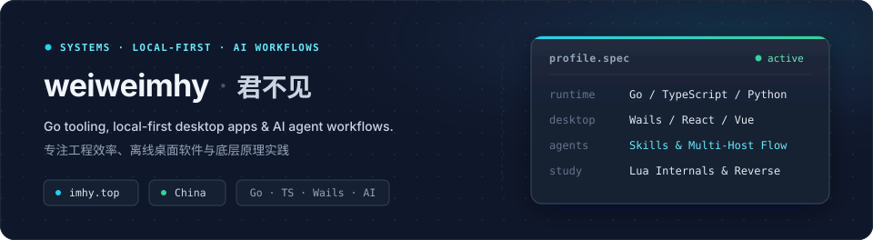

<picture>
  <source media="(prefers-color-scheme: dark)" srcset="./assets/header-dark.svg">
  <source media="(prefers-color-scheme: light)" srcset="./assets/header-light.svg">
  
</picture>

 

> **Systems-minded builder** focused on Go engineering, local-first desktop software, and practical AI agent workflows.  
> 关注清晰的系统边界、离线优先的桌面工具、跨宿主 AI Agent 工程化实践，以及底层源码与逆向原理研究。

---

### Selected Public Work · 公开项目

| Project | Role &amp; Highlights | Status |
| :--- | :--- | :---: |
| **[agent-skills](https://github.com/weiweimhy/agent-skills)** | Cross-host Agent Skills workflow library shared across Codex &amp; Antigravity · 跨宿主 AI 技能与工作流工程体系 | `Active` |
| **[imhy.top](https://imhy.top/)** ([repo](https://github.com/weiweimhy/weiweimhy.github.io)) | Personal technical blog **「君不见」** — engineering notes, architecture write-ups &amp; deep dives | `Writing` |
| **[go-utils](https://github.com/weiweimhy/go-utils)** | Standard-library-first reusable Go v6 toolkit with lean modular submodules | `Archived` |

<em>In private incubation: local-first Markdown desktop editor &amp; personal knowledge systems.</em>

---

### Engineering Focus · 技术版图

| Domain | Core Stack &amp; Practice |
| :--- | :--- |
| **Systems &amp; Backend** | `Go` · `PostgreSQL` · `Python` · Modular Services · Clean Boundaries |
| **Desktop &amp; Frontend** | `Wails` · `TypeScript` · `React` · `Vue 3` · Local-First UX |
| **AI Agent Engineering** | `Agent Skills` · Multi-Host Workflows (`Codex` / `Antigravity`) · Evals &amp; Automation |
| **Deep-Dive Research** | `Lua 5.4 Internals` · `Windows / Android Reverse Engineering` · Systems Fundamentals |

---

  Notes &amp; Essays · <a href="https://imhy.top/">imhy.top（君不见）</a>

